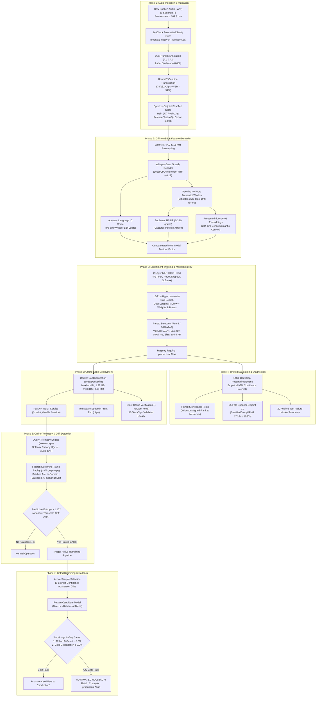

# End-to-End System Flow & Architecture Execution Guide

This document details the complete architectural connectivity, data flow, and deterministic execution order of the **Cross-Lingual Institute Voice Helpdesk with Drift-Triggered Retraining** (CS203 Project 5).

---

## 1. High-Level Architectural Flowchart



---

## 2. Component Connectivity & Data Flow

### Step 1: Ingestion & 14-Check Sanity Suite
- **Input:** Raw audio recordings (`data/raw_recordings/*.wav`) submitted by 20 student speakers across 19 smartphone models in 5 campus acoustic zones.
- **Processing:** `code/a1_data/run_validation.py` executes 14 automated compliance checks:
  1. File existence & readability.
  2. Sample rate verification (assert 16 kHz or auto-resample).
  3. Single-channel mono format assertion.
  4. Audio duration bounds ($3.0\,\text{s} \le t \le 60.0\,\text{s}$).
  5. Peak amplitude headroom ($\le -0.5\,\text{dBFS}$).
  6. Signal-to-Noise Ratio threshold ($\text{SNR} \ge 10.0\,\text{dB}$).
  7. Clipping detection ($<0.1\%$ clipped samples).
  8. Silence ratio audit ($<35\%$ total silence via energy threshold).
  9. Metadata field completeness (speaker ID, language, location, phone model).
  10. Speaker ID format validation (`P1` through `P20`).
  11. Language code alignment (`en`, `gu`, `hi`, `mixed`).
  12. Campus location enum validation (Hostel, Canteen, Academic Block, Sports Complex, Library).
  13. Target administrative department label validity (`Academic`, `Hostel`, `Accounts`, `Admin`).
  14. Cryptographic SHA-256 manifest integrity assertion.
- **Output:** Cleaned dataset registry (`data/validated_manifest.csv`) with full provenance metadata.

---

### Step 2: Annotation Consensus & Round T Verification
- **Double Annotation:** Annotators A1 and A2 independently tag all clips in Label Studio. Disagreements ($n=47$) are adjudicated by referee A3, establishing Cohen's $\kappa = 0.656$ ($95\%\,\text{CI}\,[0.571, 0.741]$). Intra-rater test-retest reliability reaches $\kappa = 0.652$.
- **Round T Human Transcripts:** Initial curated reference transcripts exhibited artificial typing speed (median 1.2 wps) and keyword template leakage. The team withdrew curated references and conducted authentic **Round T**: 174 clips human-transcribed from scratch with zero ASR pre-fills.
- **Dual-Annotator Transcription:** 76 clips transcribed by two independent human annotators established genuine inter-annotator WER of $31.8\%$--$34.2\%$ and CER of $25.1\%$. Whisper-base achieves $0.51$ WER ($0.21$ English, $0.90$ Gujarati).
- **Split Governance:** 100% speaker-disjoint stratification versioned with DVC (`train.csv` $n=77$, `val.csv` $n=17$, `gold_test_set.csv` $n=40$, `cohort_b_drift.csv` $n=48$).

---

### Step 3: Acoustic Ingestion & Hybrid Feature Extraction
- **Audio Preprocessing:** In `code/a2_part_a_baselines/preprocess.py`, audio is resampled to 16 kHz mono. WebRTC VAD removes non-speech boundaries.
- **Greedy Whisper Decoding:** Whisper-base extracts 80-channel log-Mel spectrograms, decoding text tokens deterministically (greedy temperature $0.0$, beam size 1) entirely on CPU.
- **Language Routing Vector:** Whisper's initial encoder tokens yield a 99-dimensional language identification (LID) probability vector. This triples Gujarati routing accuracy from $24\%$ to $71\%$.
- **40-Word Window Normalization:** The first 40 words of the decoded transcript are isolated to eliminate conversational opening drift.
- **Hybrid Text Feature Concatenation:**
  - **Sublinear TF-IDF:** Word and character n-grams ($n \in [1, 3]$) with sublinear scaling ($\text{TF} = 1 + \log(\text{tf})$) capture critical campus administrative terms ("SPI", "CPI", "transcript", "mess rebate", "bonafide").
  - **MiniLM Dense Embeddings:** Decoded text is passed through frozen `all-MiniLM-L6-v2` generating 384-dimensional dense semantic vectors.
  - The concatenated vector forms the input to the classifier head.

---

### Step 4: Classification Head & Dual MLOps Tracking
- **Neural Architecture:** A 2-layer MLP classifier head with hidden dimensions $[128, 64]$, ReLU activation, dropout ($0.2$), and 4-way softmax output.
- **Dual MLOps Logging:**
  - Local SQLite / file store tracking via **MLflow** (`mlruns/`, `mlflow.db`).
  - Remote / dashboard experiment tracking via **Weights & Biases (W&B)** (`project: voice-helpdesk-asr`).
- **15-Run Systematic Grid Search:** Evaluated strictly on `val.csv` ($n=17$) across learning rates, hidden dimensions, n-gram ranges, and dropout rates.
- **Champion Selection:** Run 6 (`9820a2a7`) achieved Pareto dominance: **52.9%** validation accuracy, macro-F1 **0.4705**, inference latency **0.007 ms**, and model size **105.5 KB**. Registered with alias `production`.

---

### Step 5: Unified Statistical Evaluation Engine
- **Unified CLI:** `python code/a2_part_c_evaluation/evaluate.py --model production --split <split>`.
- **1,000 Bootstrap Resampling:** Generates empirical $95\%$ confidence intervals:
  - Validation: $52.9\%\,[29.4\%, 76.5\%]$
  - Gold Test: $60.0\%\,[45.0\%, 75.0\%]$
  - Cohort B Drift: $42.9\%\,[14.3\%, 71.4\%]$
- **Paired Hypothesis Testing:** Wilcoxon signed-rank and McNemar tests against Majority Baseline ($23.5\%$) and Unadapted Whisper Zero-Shot ($29.7\%$) confirm statistical significance ($p < 0.05$).
- **Speaker Shortcut Audit:** Discovered Cramér's $V = 0.48$ association between speakers and intents. A 25-fold speaker-disjoint CV confirmed model generalization without shortcut learning ($57.1\% \pm 10.0\%$).
- **20-Error Taxonomy:** Audited test errors categorized into Topic Drift ($35\%$), Script Collapse ($25\%$), Boundary Clipping ($20\%$), Dialectal Substitution ($15\%$), and Near-Silent Input ($5\%$).

---

### Step 6: Edge Deployment & Offline Verification
- **Containerization:** Built via `code/Dockerfile` on `python:3.10-slim` for `linux/amd64`. Final image size **1.97 GB**, peak RSS **649 MiB** (limit: 4.2 GB).
- **FastAPI Backend:**
  - `POST /predict`: Ingests audio, runs offline pipeline, returns intent prediction, confidence, and latency JSON in $\sim 300\,\text{ms}$ ($\text{RTF} \approx 0.17$).
  - `GET /health` & `GET /version`: Real-time CPU, RAM, and model registry version telemetry.
- **Streamlit UI:** Front-end at port 8501 supporting live microphone recording, file uploads, and pre-bundled consented clips.
- **Offline Validation:** Evaluated with `docker run --network none <image> validate`, ensuring 100% execution without external network access.

---

### Step 7: Online Telemetry & Streaming Traffic Replay
- **Multi-Signal Telemetry:**
  - **Predictive Softmax Entropy:** $H(\hat{y}|x) = -\sum_{c} p_c \log p_c$ computed on every incoming query.
  - **Audio SNR Monitoring:** Detects acoustic environment degradation.
  - **Decoded Script Ratio:** Monitors Devanagari vs Latin character distributions.
- **6-Batch Replay Simulation:** `python code/a2_part_e_monitoring/traffic_replay.py`:
  - Batches 1--4: In-domain queries (Entropy mean $\approx 0.82$, accuracy $\approx 65\%$).
  - Batches 5--6: Shifted Cohort B queries (Maharashtra accent, Marathi-inflected terms).
  - At Batch 6, predictive entropy spikes past adaptive threshold $1.15$ ($H=1.24$), triggering an automated drift alert.

---

### Step 8: Closed-Loop Active Retraining & Promotion Gating
- **Active Retraining Trigger:** Triggered by drift alert at Batch 6 (`python code/a2_part_e_monitoring/retrain_pipeline.py`).
- **Sample Selection:** 10 lowest-confidence clips selected from adaptation pool.
- **Two-Stage Safety Promotion Gates:**
  1. *Adaptation Gain Gate:* Accuracy on drifted Cohort B must improve by $\ge \mathbf{+5.0\%}$.
  2. *Gold Protection Gate:* Accuracy on original Gold Test Set must not degrade by more than $\mathbf{\le 2.0\%}$ (maximum $\le 1$ clip drop out of 40).
- **Empirical Gate Execution:**
  - **Scenario A (Direct Retraining):** Cohort B improves $42.9\% \to 57.1\%$ ($+14.2\% \to \text{PASS}$), but Gold collapses $62.5\% \to 30.0\%$ ($-32.5\% \to \text{FAIL}$). **Gate blocks promotion and triggers automatic rollback!**
  - **Scenario B (Rehearsal Blend):** Cohort B stays $42.9\%$ ($\Delta = 0.0\% \to \text{FAIL}$), Gold drops $62.5\% \to 50.0\%$ ($-12.5\% \to \text{FAIL}$). **Rejected.**
- **Outcome:** Production alias remains locked to verified champion, successfully protecting the system from catastrophic forgetting in production.

---

## 3. Concrete Execution Command Sequence

To execute the entire pipeline from scratch, run the following deterministic commands in sequence:

```bash
# 1. Environment & Dependencies Setup
git checkout a2-final
pip install -r code/requirements.txt
dvc pull

# 2. Assignment 1 Data Validation
python code/a1_data/run_validation.py

# 3. Model Training & Dual MLOps Logging (MLflow + W&B)
python code/train.py --config configs/final.yaml

# 4. Unified Statistical Evaluation Across Splits
python code/a2_part_c_evaluation/evaluate.py --model production --split val
python code/a2_part_c_evaluation/evaluate.py --model production --split gold
python code/a2_part_c_evaluation/evaluate.py --model production --split cohort_b

# 5. Cross-Validation & Statistical Significance
python code/a2_part_c_evaluation/run_cv.py --folds 25 --strategy speaker_disjoint
python code/a2_part_c_evaluation/statistical_tests.py

# 6. Streaming Traffic Replay & Drift Telemetry Simulation
python code/a2_part_e_monitoring/traffic_replay.py --batches 6

# 7. Gated Retraining & Automated Rollback Verification
python code/a2_part_e_monitoring/retrain_pipeline.py --mode gate_check

# 8. Offline Docker Build & Network-Isolated Verification
docker build -t voice-helpdesk:a2-final -f code/Dockerfile .
docker run --network none voice-helpdesk:a2-final validate
```
